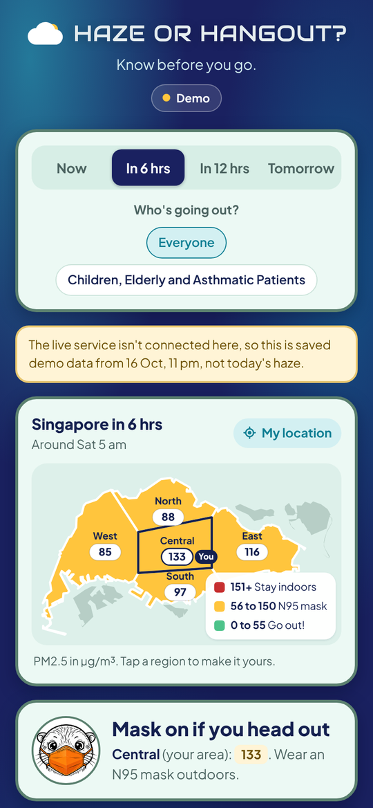

# HazeCast SG

**Haze or Hangout? Know before you go.**

HazeCast SG tells you whether the air in your part of Singapore will be fine for going out, now and over the next day. It is our group project for CS611 Machine Learning Engineering at SMU.



## The problem

Every few years, smoke from forest fires in Sumatra and Kalimantan drifts over Singapore. The air fills with tiny particles called PM2.5, small enough to get deep into your lungs. NEA tells you how bad the air is right now, but by the time the number is high, you are already outside in it.

We wanted to answer a simpler question ahead of time: should I go out, wear a mask, or stay in?

## What the app shows

Open the app and you see a map of Singapore split into NEA's five regions (North, South, East, West and Central). Each region is coloured by what you should do.

| Colour | PM2.5 (µg/m³) | What to do |
|---|---|---|
| Green | 0 to 55 | Go out! |
| Yellow | 56 to 150 | Wear an N95 mask outdoors |
| Red | 151 and above | Stay indoors |

These are NEA's own one-hour PM2.5 bands. Across the top you can switch between **Now**, **In 6 hrs**, **In 12 hrs** and **Tomorrow**.

The app also has four extra features:

1. **Use my location** picks your region for you, so the advice is about where you actually are.
2. **Who's going out?** gives stricter advice for children, the elderly and asthmatic patients.
3. **Best time to go out** compares the four time slots for your region and points to the cleanest one.
4. **How sure are we?** tells you how often each forecast caught unhealthy air when we tested it on past haze, and whether the model's latest health check passed.

The [user guide](docs/USER_GUIDE.md) walks through each part of the screen.

## How it works, in one paragraph

Every hour, the pipeline downloads three things: PM2.5 readings for each region from data.gov.sg, weather (wind, rain) from Open-Meteo, and fire hotspots seen by NASA satellites. It cleans them in stages and joins them into one table with a row per hour. A machine learning model (XGBoost) then forecasts PM2.5 for each region 6, 12 and 24 hours ahead, and a small web service serves those numbers to the app. Airflow runs all of this on a schedule and keeps checking that the model is still doing a good job.

```
 NEA PM2.5 · Open-Meteo weather · NASA fire hotspots
          │
          ▼
 raw → bronze (fixed) → silver (hourly, gaps filled) → gold (features)
          │
          ▼
 XGBoost forecasts for 6, 12 and 24 hours  →  API  →  the app
          │
          ▼
 monitoring checks, retraining when needed
```

## How good is it?

We tested the forecasts on haze from April 2024 to October 2026, a period the model never saw while learning.

| Forecast | Unhealthy hours it warned about | Right when it warned |
|---|---|---|
| 6 hours ahead | about 8 in 10 | about 6 in 10 |
| 12 hours ahead | about 7 in 10 | about 4 in 10 |
| 24 hours ahead | about 5 in 10 | about 4 in 10 |

We tuned the model to lean to the safe side. Missing a haze day is worse than a false alarm, so the number it shows is a cautious estimate and the real level is usually at or below it.

## Try it

**Just look at it.** Open `docs/index.html` in any browser. With no server running, it shows a saved demo from 16 October 2026, a real haze night.

**Run it with live data.** You need Docker Desktop and a free NASA FIRMS key.

1. Copy `.env.example` to `.env` and paste your key after `FIRMS_MAP_KEY=`.
2. In a terminal in this folder, run `docker compose up --build`.
3. Open [localhost:8000](http://localhost:8000) for the app. Airflow is at [localhost:8080](http://localhost:8080).

The [technical guide](docs/TECHNICAL_GUIDE.md) has the full set-up, including how to run each step by hand.

## Where to find things

| If you want to... | Go to |
|---|---|
| Understand the screen | [docs/USER_GUIDE.md](docs/USER_GUIDE.md) |
| See how the data was cleaned, step by step | `notebooks/01_eda.ipynb` and `notebooks/02_cleaning_and_feature_selection.ipynb` |
| Read the full technical write-up and results | [docs/TECHNICAL_GUIDE.md](docs/TECHNICAL_GUIDE.md) |
| Follow the whole pipeline in detail | [docs/PIPELINE_WALKTHROUGH.md](docs/PIPELINE_WALKTHROUGH.md) |
| See how we decide when to retrain | [docs/MODEL_GOVERNANCE.md](docs/MODEL_GOVERNANCE.md) |
| Download the data yourself | [data/README.md](data/README.md) |
| Review the team's work | [TEAM_REVIEW_GUIDE.md](TEAM_REVIEW_GUIDE.md) |

The code lives in `src/hazecast/`, the API and app in `serving/`, the Airflow jobs in `dags/` and the tests in `tests/`.

## A note on the advice

This is a student project, not an official service. The colours for everyone follow NEA's PM2.5 bands. The stricter advice for children, the elderly and asthmatic patients (green up to 35, yellow up to 55, red from 56) is our own cautious rule. For official advice, check [haze.gov.sg](https://www.haze.gov.sg).

## Data credits

PM2.5 readings from NEA via data.gov.sg. Weather from Open-Meteo. Fire hotspots from NASA FIRMS. Singapore map outline from geoBoundaries (CC BY 4.0).
