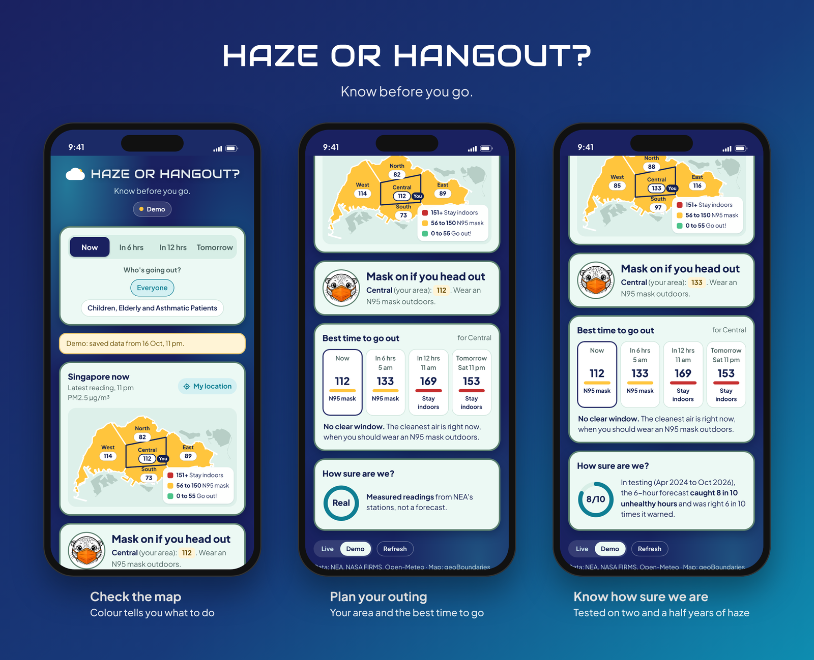
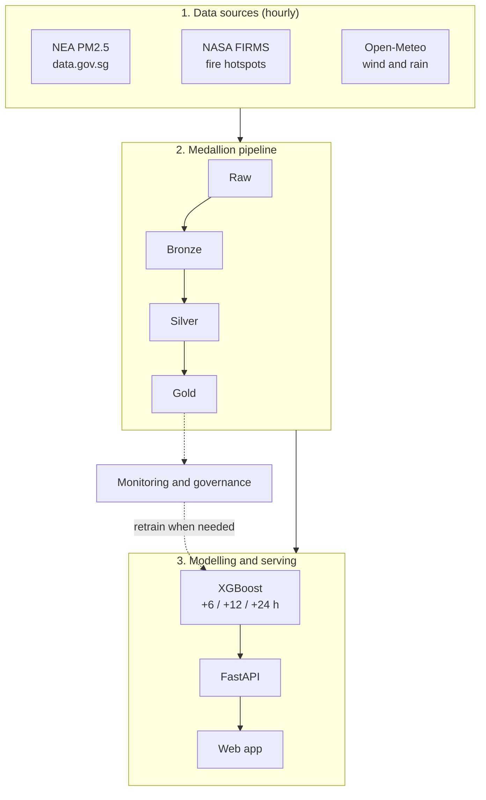

<h1 align="center">HazeCast SG</h1>

<p align="center">
  <b>Haze or Hangout? Know before you go.</b><br>
  Hourly PM2.5 haze forecasting for Singapore, 6 to 24 hours ahead, served through a mobile-first web app.
</p>

<p align="center">
  
</p>

---

## Contents

- [Overview](#overview)
- [Key features](#key-features)
- [Architecture](#architecture)
- [Tech stack](#tech-stack)
- [Getting started](#getting-started)
- [Using the app](#using-the-app)
- [Model performance](#model-performance)
- [MLOps: automation, monitoring and governance](#mlops-automation-monitoring-and-governance)
- [Repository structure](#repository-structure)
- [Documentation](#documentation)
- [Limitations and next steps](#limitations-and-next-steps)
- [Team](#team)
- [Data sources and acknowledgements](#data-sources-and-acknowledgements)

---

## Overview

Transboundary haze from forest fires in **Sumatra** and **Kalimantan** periodically pushes Singapore's air quality into unhealthy levels. The main pollutant is **PM2.5**, fine particles that penetrate deep into the lungs. In 2026, Singapore recorded **660 hours** in which at least one region reached NEA's "Elevated" band (56 µg/m³ or above) up to 18 October, the highest count since 2015.

Official readings describe the air **as it is now**. Outdoor operations teams (events, schools, construction) and members of the public need to know **in advance** whether to go ahead, take precautions or move indoors.

**HazeCast SG** addresses this with an end-to-end machine learning system that:

- **ingests** live PM2.5, weather and satellite fire data every hour,
- **forecasts** PM2.5 for each of Singapore's five NEA regions at **+6, +12 and +24 hours**,
- **translates** each forecast into clear advice: **go out**, **wear an N95 mask** or **stay indoors**,
- **monitors** its own data quality and accuracy, and **retrains** under defined governance rules.

> [!NOTE]
> This project was built for **CS611 Machine Learning Engineering** at Singapore Management University (Group 4). It is a working prototype, not an official advisory service.

---

## Key features

| Feature | Description |
|---|---|
| **Regional advice map** | Singapore's five NEA regions, each coloured by recommended action and labelled with its PM2.5 value |
| **Forecast horizons** | Switch between **Now** (measured), **In 6 hrs**, **In 12 hrs** and **Tomorrow** |
| **Location-aware** | **Use my location** selects the nearest region. Location is processed on the device only |
| **Sensitive groups mode** | Stricter thresholds for **children, the elderly and asthmatic patients** |
| **Best time to go out** | Compares all four time slots for the user's region and recommends the cleanest |
| **Forecast confidence** | Shows tested accuracy for the selected horizon and the result of the latest model health check |
| **Late-data handling** | If a source is delayed, forecasts whose target time has passed are greyed out and the delayed source is named |
| **Offline demo** | A real snapshot (16 Oct 2026, 11 pm) is embedded, so the app works with no server or internet |

**Advice bands** (NEA one-hour PM2.5 bands):

| Colour | PM2.5 (µg/m³) | General public | Children, elderly and asthmatic patients |
|---|---|---|---|
| **Green** | 0 to 55 | Go out | Go out (0 to 35 only) |
| **Yellow** | 56 to 150 | Wear an N95 mask outdoors | Short trips only, with a mask (36 to 55) |
| **Red** | 151 and above | Stay indoors | Stay indoors (from 56) |

---

## Architecture



| Layer | Purpose |
|---|---|
| **Raw** | Source files exactly as downloaded |
| **Bronze** | Known source defects repaired (for example a malformed timestamp and duplicated readings) in a consistent schema |
| **Silver** | All sources aligned to one hourly Singapore-time grid, with short gaps filled and flagged |
| **Gold** | Model features: recent PM2.5, rolling fire counts, rainfall, and wind alignment with each fire region |

One model is trained per **region and horizon** (18 in total). Candidates are compared by forward validation, prioritising **F2 on elevated hours** (recall weighted above precision), because a missed haze hour costs more than a false alarm. The production model is **XGBoost with a quantile (85th percentile) objective**, which deliberately forecasts on the cautious side.

---

## Tech stack

| Area | Tools |
|---|---|
| **Language** | Python 3 |
| **Data processing** | pandas, NumPy, Parquet (PyArrow) |
| **Modelling** | XGBoost, LightGBM, scikit-learn |
| **Experiment tracking** | MLflow |
| **Orchestration** | Apache Airflow (five DAGs) with PostgreSQL |
| **Serving** | FastAPI, Uvicorn |
| **Front end** | Single-file HTML, CSS and JavaScript (no framework, works offline) |
| **Containerisation** | Docker, Docker Compose |
| **Visualisation and exploration** | Matplotlib, Plotly, JupyterLab |
| **Testing** | pytest |
| **Data versioning** | Git LFS for the raw seed data |

---

## Getting started

### Prerequisites

- **Docker Desktop**, installed and running
- **Git** and **Git LFS**
- A free **NASA FIRMS map key**: <https://firms.modaps.eosdis.nasa.gov/api/map_key/>

### Option 1: View the demo (no setup)

Open **`docs/index.html`** in any modern browser. The app loads an embedded snapshot and labels it **Demo**.

### Option 2: Run the full system

**1. Clone the repository**

```bash
git lfs install
git clone https://github.com/mariamustafadoola-gif/Haze-Cast-SG.git
cd Haze-Cast-SG
```

**2. Configure environment variables**

```bash
cp .env.example .env
```

Open `.env` and set `FIRMS_MAP_KEY`. `DATA_GOV_SG_API_KEY` is optional.

> [!CAUTION]
> `.env` contains credentials and is excluded by `.gitignore`. **Do not commit it.**

**3. Build and start the services**

```bash
docker compose up -d --build
```

**4. Load the historical data (first run only)**

Open Airflow at <http://localhost:8080> (local credentials **admin / admin**), locate **`hazecast_backfill`** and select **Trigger DAG**. This downloads missing history from April 2014 onwards, builds every data layer and trains the initial models.

**5. Open the app**

Go to <http://localhost:8000>. The hourly job produces a new forecast at **10 minutes past every hour**.

**6. Stop the services**

```bash
docker compose down
```

### Service endpoints

| Service | URL | Purpose |
|---|---|---|
| **Web app** | <http://localhost:8000> | Haze or Hangout? interface |
| **API documentation** | <http://localhost:8000/docs> | Interactive OpenAPI documentation |
| **Airflow** | <http://localhost:8080> | Pipeline scheduling and monitoring |
| **MLflow** | <http://localhost:5000> | Experiment tracking and model comparison |
| **JupyterLab** | <http://localhost:8888/lab> | Notebooks |

> [!TIP]
> Ports can be changed in `.env` (for example `API_PORT=8001`) if they clash with other software.

To run individual pipeline stages in Python without Docker, see the [Technical guide](docs/TECHNICAL_GUIDE.md).

---

## Using the app

1. **Select a time horizon:** **Now**, **In 6 hrs**, **In 12 hrs** or **Tomorrow**.
2. **Select who is going out:** **Everyone**, or **Children, Elderly and Asthmatic Patients**.
3. **Select your region:** choose **Use my location**, or tap a region on the map.
4. **Read the recommendation** in the summary card below the map.
5. **Plan ahead** with **Best time to go out**, which highlights the cleanest time slot.

The [User guide](docs/USER_GUIDE.md) covers every screen element, status message and troubleshooting step.

---

## Model performance

Evaluated on a held-out period from **April 2024 to October 2026**, pooled across all regions. An "unhealthy hour" is one at or above **56 µg/m³**.

| Horizon | Recall (unhealthy hours caught) | Precision (warnings that were correct) | Mean absolute error |
|---|---|---|---|
| **+6 hours** | 0.82 | 0.61 | 8.0 µg/m³ |
| **+12 hours** | 0.66 | 0.39 | 9.0 µg/m³ |
| **+24 hours** | 0.52 | 0.36 | 9.0 µg/m³ |

The quantile objective trades precision for recall by design: the forecast is a cautious upper estimate, so actual levels are usually at or below it. Full results, per-region charts and model comparisons are in the [Technical guide](docs/TECHNICAL_GUIDE.md) and [`reports/`](reports/).

---

## MLOps: automation, monitoring and governance

Five Airflow DAGs run the system end to end:

| DAG | Schedule (SGT) | Responsibility |
|---|---|---|
| **`hazecast_hourly`** | Every hour at :10 | Fetch live data, rebuild layers, publish 18 forecasts. **Skips** if features are stale rather than serving an outdated forecast as current |
| **`hazecast_monitoring`** | Daily at 01:30 | Data quality, model quality, bias drift and feature attribution drift, followed by a governance decision |
| **`hazecast_haze_monitoring`** | 07:30, 13:30, 19:30 during haze episodes | The same checks at higher frequency while any region is elevated |
| **`hazecast_retrain`** | 1st of each month, or on trigger | Champion/challenger retraining with a promotion gate |
| **`hazecast_backfill`** | Manual | Historical download and initial training |

**Governance decisions** produced by monitoring:

| Decision | Trigger | Action |
|---|---|---|
| **None** | All monitors healthy | No action |
| **Investigate** | Drift or bias alerts without confirmed performance loss | Model owner reviews |
| **Retrain** | Confirmed performance loss, or drift that has changed model behaviour, or model age | Retraining runs automatically |
| **Fix data** | Missing or stale inputs | Data owner repairs the source; no retraining on broken data |

A challenger is promoted only if it passes **integrity checks**, detects elevated hours **within tolerance of a persistence baseline** in most groups, and shows **no regression** against the current champion. Details are in [Model governance](docs/MODEL_GOVERNANCE.md).

---

## Repository structure

```
.
├── dags/                 Airflow DAGs (hourly, monitoring, haze monitoring, retrain, backfill)
├── data/                 Raw seed data (Git LFS) and generated layers (not committed)
├── docker/               Dockerfiles
├── docs/                 Documentation, images, and the GitHub Pages copy of the app
├── experiments/          Experiments supporting design decisions
├── notebooks/            EDA, cleaning and feature selection, pipeline walkthrough
├── reports/              Evaluation metrics and charts
├── serving/              FastAPI application and web app (static/index.html)
├── src/hazecast/         Core package: ingestion, transformation, training, inference, monitoring
├── tests/                pytest suite
├── docker-compose.yml    Full local stack
└── requirements*.txt     Python dependencies
```

---

## Documentation

| Document | Audience | Contents |
|---|---|---|
| [User guide](docs/USER_GUIDE.md) | Everyone | How to use the app, every message explained, troubleshooting |
| [Technical guide](docs/TECHNICAL_GUIDE.md) | Engineers | Full technical write-up, results and manual run instructions |
| [Pipeline walkthrough](docs/PIPELINE_WALKTHROUGH.md) | Engineers | The pipeline from ingestion to forecast, stage by stage |
| [Model governance](docs/MODEL_GOVERNANCE.md) | Model and data owners | Monitoring thresholds, retraining rules and responsibilities |
| [Data sources](data/README.md) | Data engineers | How each dataset is obtained, automatically or by hand |
| [Team review guide](TEAM_REVIEW_GUIDE.md) | Contributors | Which files cover which part of the work |
| `notebooks/` | Everyone | Step-by-step data exploration, cleaning and feature selection |

---

## Limitations and next steps

- **Longer horizons are harder.** At +24 hours, a simple persistence forecast ("the level will stay the same") currently detects more elevated hours than the model during long episodes. The [governance document](docs/MODEL_GOVERNANCE.md) proposes combining the two for +12 h and +24 h warnings.
- **Wind is measured at Singapore only.** Smoke transport along the full path from the fire regions is not modelled.
- **Hosting.** The system currently runs locally with Docker. A cloud deployment would make the live app publicly available.
- **Alerts.** Push or email notifications when a region is forecast to turn red would increase practical value.
- **Sensitive-group thresholds** are a conservative project choice and would benefit from review against public health guidance.

---

## Team

**Group 4, CS611 Machine Learning Engineering, Singapore Management University**

Anuprabha Thiruppathi · Devershi Shukla · Lim Eng Soon · Maria Mustafa Doola · Pei Han Wen

---

## Data sources and acknowledgements

- **PM2.5 readings:** National Environment Agency (NEA), via [data.gov.sg](https://data.gov.sg)
- **Fire hotspots:** NASA FIRMS (VIIRS)
- **Weather:** [Open-Meteo](https://open-meteo.com)
- **Singapore boundary:** geoBoundaries (CC BY 4.0)
- **Fonts:** Audiowide and Plus Jakarta Sans (SIL Open Font License)

> [!WARNING]
> HazeCast SG is an academic prototype and does not replace official guidance. For official haze advisories, refer to [haze.gov.sg](https://www.haze.gov.sg).
