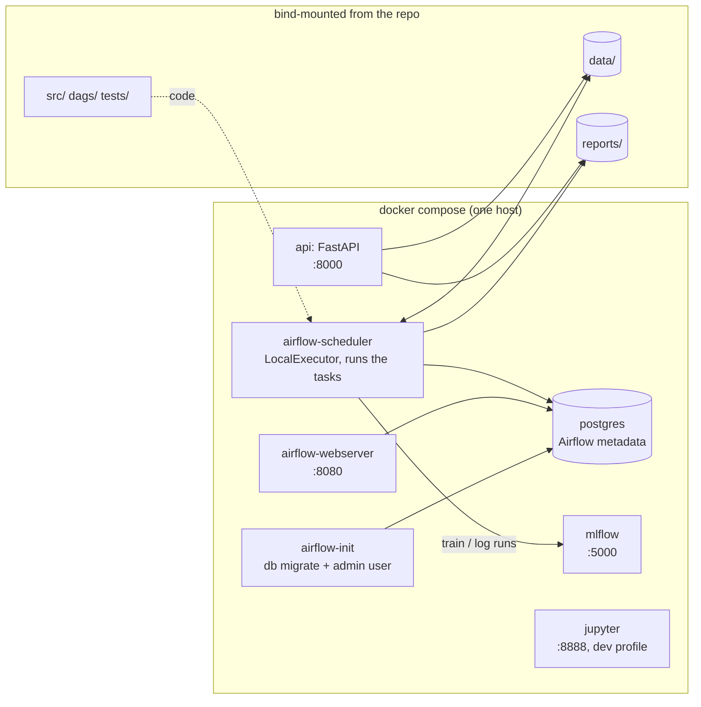
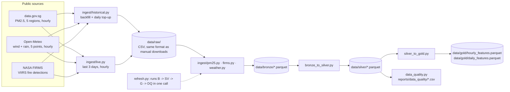
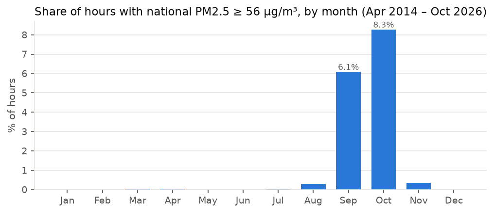
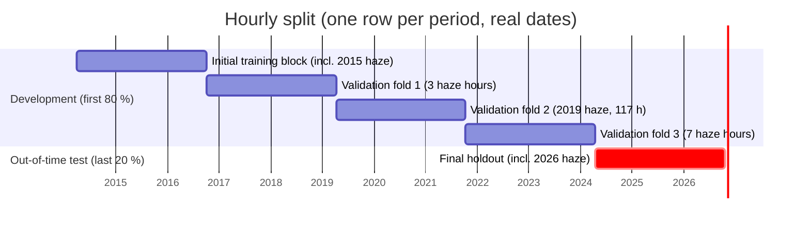
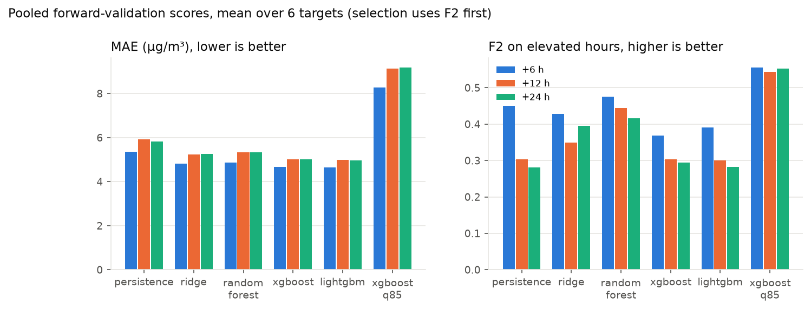
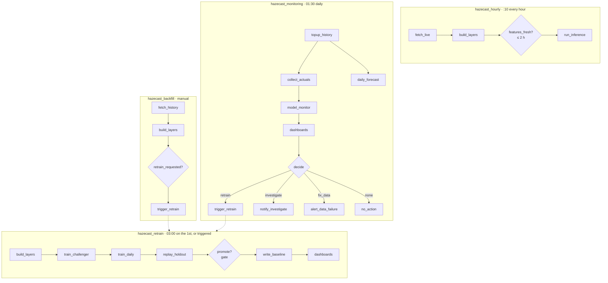
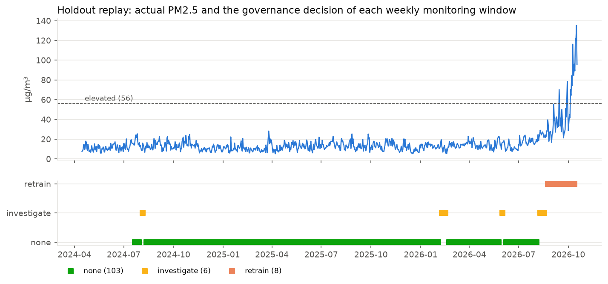
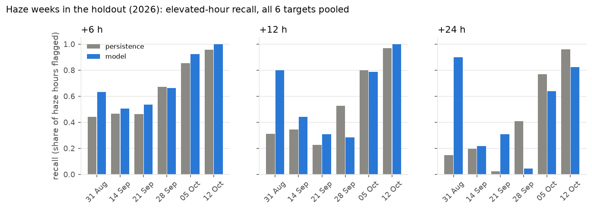
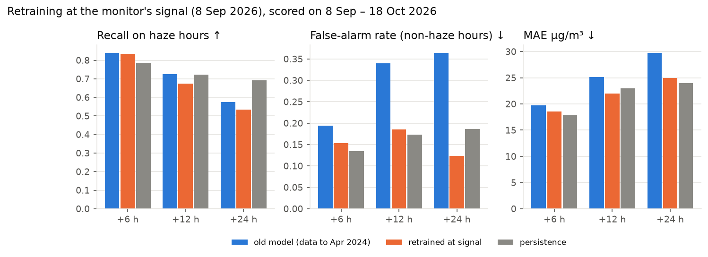

# HazeCast SG: end-to-end pipeline walkthrough

This walkthrough covers the whole system on the `e2e-pipeline` branch:
how to run it, where the data comes from and how it is transformed, how
the models are trained, selected and served, and how Airflow orchestrates
and monitors it all. Every number below comes from running this pipeline
on the real data (April 2014 to October 2026), unless it is marked as a
design value. The scripts that reproduce the evidence are named in each
section.

**Contents**

1. [Running it: Docker, Airflow, and without Docker](#1-running-it)
2. [Data pipeline: sources, EDA, ingestion, processing, transformation](#2-data-pipeline)
3. [Model pipeline: training, splits, selection, inference](#3-model-pipeline)
4. [Orchestration and monitoring: DAGs, triggers, drift, thresholds, interventions](#4-orchestration-and-monitoring)
5. [Known limitations and open decisions](#5-known-limitations-and-open-decisions)

Companion documents: [`MODEL_GOVERNANCE.md`](MODEL_GOVERNANCE.md) (the
SOP itself), [`../data/README.md`](../data/README.md) (data download
reference), and the data team's notebooks `notebooks/01_eda.ipynb` and
`notebooks/02_cleaning_and_feature_selection.ipynb`.

---

## 1. Running it

### 1.1 What runs where



Two images are built from the repo:

| Image | Dockerfile | Used by | Contents |
|---|---|---|---|
| `hazecast-airflow` | `docker/airflow.Dockerfile` | airflow-init, -webserver, -scheduler | `apache/airflow:2.10.5-python3.11` + `libgomp1` + `requirements-pipeline.txt`, installed together with a pin on `apache-airflow==2.10.5`, so pip cannot upgrade Airflow's own dependencies |
| `hazecast-pipeline` | `docker/pipeline.Dockerfile` | api, jupyter | `python:3.11-slim` + `libgomp1` + `requirements.txt` (pipeline + Jupyter + pytest) |

The code is **mounted, not baked in** (`./src`, `./dags`, `./data`,
`./reports`, `./tests`). A code change therefore takes effect on the next
task run without rebuilding. Rebuild only when the requirements change.

### 1.2 First-time setup

```bash
git clone <repo> && cd hazecast-sg && git checkout e2e-pipeline
git lfs pull                      # the committed raw-data seed (optional: the backfill DAG can fetch it all)
cp .env.example .env
```

Edit `.env`:

| Variable | Needed? | Why |
|---|---|---|
| `FIRMS_MAP_KEY` | **Yes, for live forecasts.** Free from <https://firms.modaps.eosdis.nasa.gov/api/map_key/> | Without it the fire features stop at the last committed day, so the hourly DAG's freshness gate correctly refuses to forecast and the monitor reports `fix_data` (verified, see §4.6) |
| `DATA_GOV_SG_API_KEY` | Optional | Raises data.gov.sg rate limits; without it the PM2.5 per-day backfill is paced at 1.5 s per request |
| `AIRFLOW_PORT`, `MLFLOW_PORT`, `API_PORT`, `JUPYTER_PORT` | Only on a clash | Host ports. Example: another Airflow already on 8080, so set `AIRFLOW_PORT=8081` |

### 1.3 Build and start

```bash
docker compose build                         # ~25 min the first time (Airflow image)
docker compose up -d                         # postgres -> airflow-init -> webserver + scheduler, mlflow, api
docker compose ps                            # airflow-init should be "exited (0)", the rest "running"
docker compose --profile dev up -d jupyter   # optional: JupyterLab
```

Startup order is enforced by `depends_on`. Postgres must be healthy before
`airflow-init` runs `airflow db migrate` and creates the `admin` user, and
the webserver and scheduler wait for init to finish successfully.

| UI | URL | Login |
|---|---|---|
| Airflow | `http://localhost:8080` (or your `AIRFLOW_PORT`) | `admin` / `admin` (local only: change before exposing) |
| MLflow | `http://localhost:5000` | none |
| API docs | `http://localhost:8000/docs` | none |
| Live monitoring dashboard | `http://localhost:8000/monitoring/dashboard` | none |
| Holdout replay dashboard | `http://localhost:8000/monitoring/dashboard?kind=backtest` | none |

### 1.4 Airflow setup and first run

Settings, all in `docker-compose.yml`:
- **Executor:** `LocalExecutor` with Postgres. Tasks of different DAGs can run in parallel (for example, the hourly forecast during a long retrain).
- **Timezone:** `Asia/Singapore` for the scheduler, the UI and the DAG `start_date`, so every cron expression below is Singapore time.
- **Pausing:** `DAGS_ARE_PAUSED_AT_CREATION=false`, so the four DAGs start on their schedules as soon as they are parsed.
- **Credentials:** `FIRMS_MAP_KEY`, `DATA_GOV_SG_API_KEY` and `MLFLOW_TRACKING_URI=http://mlflow:5000` are passed into the containers.

First run, once:
1. In the Airflow UI open **`hazecast_backfill`**, then **Trigger DAG w/ config** (defaults are fine: `start`=2014-04-01, `end`=yesterday, `retrain`=true).
   This downloads whatever history is missing, rebuilds bronze/silver/gold, and triggers **`hazecast_retrain`**.
2. `hazecast_retrain` takes about an hour on a laptop: six candidates × 6 targets × 3 horizons with forward validation, then the holdout replay. It promotes the first champion and writes the monitoring baseline.
3. From then on `hazecast_hourly` forecasts every hour at :10, and `hazecast_monitoring` runs at 01:30 every night.

The same actions from the command line:

```bash
docker compose exec airflow-scheduler airflow dags trigger hazecast_backfill --conf '{"start": "2014-04-01"}'
docker compose exec airflow-scheduler airflow dags list-runs -d hazecast_retrain
docker compose exec airflow-scheduler airflow tasks states-for-dag-run hazecast_hourly <run_id>
docker compose exec airflow-scheduler airflow dags pause hazecast_hourly     # stop forecasting
docker compose exec airflow-scheduler python -m hazecast.governance status    # current champion
docker compose exec airflow-scheduler python -m hazecast.governance rollback  # previous champion
docker compose exec airflow-scheduler python -m pytest /opt/airflow/tests -q  # 30 tests incl. DAG structure
```

Task logs are in the UI (task → Logs) and in the `airflow_logs` volume.

### 1.5 Without Docker

```bash
pip install -r requirements.txt && export PYTHONPATH=src
python -m hazecast.ingest.historical          # history (only what's missing)
python -m hazecast.refresh --days 3           # live hours + bronze/silver/gold + data-quality report
python -m hazecast.hourly_model               # train and select the 18 hourly models (writes production directly)
python -m hazecast.monitor_backtest           # holdout replay -> reports/monitoring/backtest_dashboard.html
python -m hazecast.model_monitor baseline     # monitoring baseline for the champion
python -m hazecast.inference                  # 18 forecasts -> ledger + data/gold/latest_hourly_forecast.json
python -m hazecast.monitoring                 # next day: NEA actuals for archived forecasts
python -m hazecast.model_monitor run          # four monitors + governance decision
python -m hazecast.dashboard                  # reports/monitoring/dashboard.html
uvicorn serving.app:app                       # API
```

### 1.6 Troubleshooting

| Symptom | Cause | Fix |
|---|---|---|
| `airflow-webserver` won't start, "port is already allocated" | another service on 8080 | set `AIRFLOW_PORT` in `.env`, then `docker compose up -d` |
| `hazecast_hourly` ends with `run_inference` **skipped** | freshness gate: newest complete feature row > 2 h old (usually no `FIRMS_MAP_KEY`, or a source API down) | add the key, or check `fetch_live` logs; this is intended behaviour, not a bug |
| Monitoring DAG takes the `alert_data_failure` branch | data-quality *fail* (stale features or missing columns) | same as above; see `data/monitoring/latest_model_monitor.json` |
| `ImportError ... FallbackAsyncAdaptedQueuePool` (local venv) | SQLAlchemy 2.1 with MLflow 2.x | `pip install "sqlalchemy<2.1"` (pinned in `requirements-pipeline.txt`) |
| `UnicodeDecodeError` reading weather CSVs on Windows | old files written in cp1252 | re-run `python -m hazecast.ingest.live` (files are now written as UTF-8) |

---

## 2. Data pipeline

### 2.1 Overview



### 2.2 Data sources

| Source | What | Grain and coverage | API used by the scripts | Key |
|---|---|---|---|---|
| **NEA PM2.5** via data.gov.sg (dataset `d_6c0d5fc34838b12472475fdb73c0af29`) | 1-hour PM2.5 for north/south/east/west/central (µg/m³). **Label and persistence feature** | hourly, 2014-04-01 to now | bulk: `GET /v1/public/api/datasets/{id}/initiate-download` then `/poll-download`, which returns a signed S3 CSV URL (file ends ~3 weeks behind today; checked 2026-10-25: last row 1 Oct 2026). Per day: `GET /v2/real-time/api/pm25?date=YYYY-MM-DD` (served from mid-2016; paginated) | optional |
| **Open-Meteo** (default model blend) | wind speed, wind direction, precipitation at Singapore + 4 fire-province points (Riau, Palembang, Pontianak, Palangka Raya) | hourly, 2014-04-01 to now | history: `archive-api.open-meteo.com/v1/archive` (one request per point per year). Live: `api.open-meteo.com/v1/forecast?past_days=N`, future hours trimmed | none |
| **NASA FIRMS** (VIIRS S-NPP) | active-fire detections over Sumatra + Kalimantan | per detection, 2014-01-01 to now | `firms.modaps.eosdis.nasa.gov/api/area/csv/{KEY}/{SOURCE}/95,-6.2,119.5,6/{days≤5}/{date}`. `VIIRS_SNPP_SP` (science quality) up to the date `/api/data_availability` reports, `VIIRS_SNPP_NRT` after | `FIRMS_MAP_KEY` |

The five weather points and two fire boxes are defined once in
`src/hazecast/config.py` (`WEATHER_POINTS`, `FIRE_REGIONS`).

### 2.3 EDA findings and what they decided

Source: the data team's `notebooks/01_eda.ipynb`, plus `src/hazecast/eda.py`
(`python -m hazecast.eda` writes the tables to `reports/eda/`).



| # | Finding (real data) | Decision it drove |
|---|---|---|
| 1 | 12.5 years, 110,015 hours; PM2.5 typical hour **12 µg/m³**, 1 in 100 hours above 64, **1.3 % of hours ≥ 56** (NEA "elevated") | Accuracy alone is misleading: a model can look good while missing every haze hour. Elevated-hour **recall / F2** is a first-class metric |
| 2 | Haze is **seasonal**: 6.1 % of September and 8.0 % of October hours are elevated, against under 0.5 % in every other month (chart above). Main episodes: 2015, 2019, and **Aug–Oct 2026** (2nd worst on record, still running when the data was frozen) | Evaluate on time-ordered blocks that contain whole haze seasons, never random hours. Keep 2026 out of feature selection so it stays a fair test |
| 3 | No daily cycle (hourly means 14–15 µg/m³ across the day) | No hour-of-day feature |
| 4 | The 5 regions move together (haze blankets the island) | One shared feature set, 6 targets (5 regions + national mean) |
| 5 | Fire–PM2.5 correlation strongest same-day, fading **slowly** over a week; Sumatra matters more than Kalimantan (closer) | Fire lags 0–3 days + 3/7-day rolling totals, per province |
| 6 | Haze days have **E/SE** winds (66 of 100), normal days often N | "Upwind" features: fire totals × alignment of wind with the fire→Singapore bearing |
| 7 | Rain days are slightly cleaner | Rain amounts and 3 h / 24 h totals kept |
| 8 | PM2.5 autocorrelation: 0.97 one hour ahead, weakening with horizon | Current readings (`now_*`) always kept. Any model must beat **persistence**, and the value of a model is at longer horizons |

### 2.4 Ingestion: getting raw files (automated)

| Script | Stage | Inputs | Outputs | What it does |
|---|---|---|---|---|
| `src/hazecast/ingest/historical.py` | Training history; daily top-up | the 3 APIs; existing `data/raw/` | `pm25/Historical1hrPM2.5_datagov.csv`, `pm25/..._rtapi_YYYYMM.csv`, `weather/open-meteo-..._hist_<point>_<year>.csv`, `firms/fire_archive_api_YYYYMM.csv` / `fire_nrt_api_YYYYMM.csv`, `firms/fetch_log.json` | **Coverage-driven:** first works out which days or hours already exist in the persistent raw files, then requests only the rest (details below) |
| `src/hazecast/ingest/live.py` | Inference (hourly) | the 3 APIs | `*_zlive.csv` / `*_live_<point>.csv` (overwritten each run) | Last N days from the live endpoints, in the historical file format |
| `src/hazecast/orchestration.py` `fetch_history`, `fetch_live` | Airflow wrappers | as above | XCom summary | Skip FIRMS with a warning when there is no key, so PM2.5 and weather still update |

Coverage rules in `historical.py`, and why each one exists:
- **PM2.5:** a day counts as covered with ≥ 22 hourly readings. 22 rather than 24 because a few historical days have 1–2 hours NEA never published, and requiring 24 would re-request them forever. If ≥ 30 days are missing, or anything before mid-2016 (the real-time API's limit), it downloads the bulk file once, then fetches the remainder day by day.
- **Weather:** an hour is covered when all three variables are present. Missing hours are grouped by year and fetched one request per point per year; empty rows are dropped and filled on a later day. The **last 2 days are always re-fetched** (`WEATHER_REFETCH_DAYS`) and replace the stored rows, because Open-Meteo revises its newest hours for about a day: comparing a download with a fresh one 10 days later, only the final ~4 hours had changed (wind by 1.6 to 3.3 km/h).
- **Which weather data this is:** both services return Open-Meteo's default blend of weather models, not pure ERA5 reanalysis. For recent days the archive returns exactly the same values as the live service (checked hour by hour for 22 to 25 Oct 2026), and it does not later swap them for ERA5. The data team's original downloads used the same default, so training data and live data come from the same source. Against pure ERA5 the blend differs by about 2 km/h in wind speed and about 25° in direction.
- **FIRMS:** zero-fire days produce no rows, so "covered" means a detection exists *or* the day is listed in `fetch_log.json`. Requests are runs of ≤ 5 consecutive days and never straddle the SP/NRT boundary.
- **Live files never count as history**, because they are overwritten every hour. The nightly top-up (`lookback_days=10`) copies those hours into permanent monthly/yearly files, so a missed hourly run never leaves a hole in the training data.
- **File names sort after the original manual downloads.** The bronze loaders keep the first file's value on overlaps, so the committed originals win.

Verified on 2026-10-25:
- **Fresh clone (empty `data/raw/`):** bulk PM2.5 file (2014-04-01 → 2026-10-01) plus 24 per-day API days to 24 Oct, and 3 years of weather for 5 points. Both loaded through the bronze loaders: 110,156 PM2.5 hours.
- **Existing clone:** fetched the 6 missing PM2.5 days and 192 hours per weather point. A second run requested nothing.
- **FIRMS:** covered by mocked tests (`tests/test_historical.py`: SP/NRT split, zero-fire logging, idempotency). The live call needs your key.

### 2.5 Processing: raw → bronze → silver

| Script | Layer | Inputs | Outputs | What it does |
|---|---|---|---|---|
| `ingest/pm25.py` | bronze | `data/raw/pm25/*.csv` | `data/bronze/pm25.parquet` (ts, 5 regions) | parses `d/m/YYYY H:MM`; patches the one known bad timestamp (`2016-04-04 010:00:00`); **drops and logs** any new malformed one (never guesses); keeps the first of duplicate hours |
| `ingest/firms.py` | bronze | `data/raw/firms/*.csv\|zip` | `data/bronze/firms.parquet` | unzips; archive `type==0` only (drops volcanoes and gas flares; API archive files have no `type` column and are kept as-is); dedupes on lat/lon/date/time; keeps detections inside the Sumatra / Kalimantan boxes |
| `ingest/weather.py` | bronze | `data/raw/weather/*.csv` | `data/bronze/weather.parquet` (ts, point, wind, dir, rain) | identifies each file's point from the **coordinates inside the file** (not the name), within 0.5°; dedupes overlapping hours (older file wins) |
| `bronze_to_silver.py` | silver | bronze parquet | `data/silver/pm25.parquet`, `weather.parquet`, `firms_daily.parquet`, `firms_hourly.parquet` | puts every series on a complete hourly clock (fires: daily counts, and hourly counts by detection time that stop 15 h after the latest detection); fills gaps **≤ 3 h** by time interpolation (wind direction is carried forward, because averaging 359° and 1° gives 180°) and marks them `filled`; leaves longer gaps empty; flags runs of ≥ 5 zero-fire days as likely satellite gaps (`data_gap`), **never filled** |
| `data_quality.py` | report | raw + silver | `reports/data_quality/{bronze_fixes,silver_gaps,quality_checks}.csv` | recounts every fix by re-applying the same rules, so the counts always match the pipeline; 7 pass/fail checks |

Counts from the real data (`reports/data_quality/*.csv`):

| Source | In | Removed / fixed | Kept |
|---|---|---|---|
| PM2.5 | 110,016 rows | 1 known bad timestamp fixed; 4 duplicate hours (first kept); 3 single missing hours filled | 110,012 rows → 110,015-hour silver grid, 0 empty |
| FIRMS | 3,784,277 detections | 150,990 non-vegetation; 301,783 exact repeats (overlapping downloads); 1,040,212 outside the two boxes | 2,291,292 |
| Weather | 549,840 point-hours | 6 overlapping files joined | 0 missing hours at all 5 points |
| Fire days | 4,672 days | 73 days flagged as satellite gaps (2022, 2024, 2026) | exposed to the model as `fire_data_gap_recent` |

All 7 quality checks pass. The highest hourly reading is 471 µg/m³ (2015 haze), believable for that episode.

### 2.6 Transformation: silver → gold (features and labels)

`silver_to_gold.py` builds two tables. `build_gold_hourly()` →
`data/gold/hourly_features.parquet` (110,015 hours × 56 features; the
production model) and `build_gold()` → `daily_features.parquet` (4,584
days; next-day model).

| Group | Features (hourly table) | Leak-free rule |
|---|---|---|
| Fire hotspots (22) | `fire_{sumatra,kalimantan}_lag{0..3}`, `_roll{3,7}`, `_log_lag0`, totals, `fire_data_gap_recent` | **rolling windows on detection times** (§2.7): `lag0` = detections in the 24 h ending 3 full hours before the hour (FIRMS delivery time), `lag1`–`lag3` the 24 h blocks before, `roll3`/`roll7` 72 h / 168 h. Each row only uses detections already delivered at its hour |
| Weather (25) | `wind_speed_*`, `wind_dir_*`, `rain_*_mm`, `rain_*_roll{3h,24h}` at 5 points | trailing windows only |
| Upwind (3) | `upwind_{sumatra,kalimantan,total}` = cos(wind direction − bearing from the province to Singapore), clipped at 0, × 7-day fire total | uses current-hour wind and lagged fires |
| PM2.5 now (6) | `now_{north,...,central,national}` | the reading at the forecast origin |
| Labels | `label_*` in gold is the +1 h reading. The hourly model **ignores it and rebuilds labels** at exactly t+6/12/24 h (`hourly_model.build_label`), so a gap produces a missing label, never a shifted one | `shift(-h)` on the target only |

**Feature selection (data team, 56 → 36), `experiments/feature_reduction.py`.**
The selection was made on data *outside* the haze seasons, so the 2015,
2019 and 2026 seasons stay fair tests. There were four stages:
1. exact duplicates and raw wind direction (13 dropped);
2. empty or constant features (0 dropped);
3. near-copies with |r| > 0.90 (6 dropped);
4. permutation importance across 4 periods (1 dropped).

With 36 features, error moved by < 0.3 µg/m³ and elevated-hour recall
by < 1 pp. The list is `config.SELECTED_FEATURES_HOURLY`, applied by both
`hourly_model._feature_columns` and `train._feature_columns` (the merge
kept the data team's filter, which the model branch had dropped). The
model trained here on the 36 matches the model team's 56-feature holdout
numbers: central +6 h MAE 7.78 / F2 0.69, against their 7.80 / 0.69.

### 2.7 Fire timing: how a live check found a leak and a daily forecast gap (changed 28 Oct)

**What was found.** On 28 Oct the dashboard was still showing a forecast from Monday night. The hourly runs had fetched everything but skipped the forecast. The original rule gave every hour of Singapore day D the fire count of FIRMS day D−1, and that broke in two ways:

1. **No forecasts from midnight until early afternoon.** FIRMS dates detections by UTC day. The code only created "today" once today had at least one detection, which arrives after the first satellite pass around midday. Until then no hour had fire features, so the freshness gate correctly refused. (The first live test on 26 Oct ran at 22:39, after that day's detections had arrived, which is why it passed.)
2. **Look-ahead in training.** Detection times in our data show two passes: afternoon (13:00–15:59 Singapore time) and night (01:00–04:59 the next morning, **51 %** of a UTC day's detections). So a training row at 01:00 used a count that included detections made after it.

**Options tested,** on the 2024–26 holdout (xgboost_q85, flat 0.85, trained on pre-holdout data; `experiments/fire_feature_options.py`, `reports/fire_feature_options.csv`):

| Option | Haze hours caught | False alarms | F2 | MAE | +24 h caught | 00–10 h caught |
|---|---|---|---|---|---|---|
| A: old rule (leaky, reference) | 0.692 | 1.6 % | 0.641 | 8.67 | 0.556 | 0.656 |
| B: as-of FIRMS day (D−1 from 11:00, D−2 before) | 0.639 | 1.6 % | 0.594 | 8.77 | 0.407 | 0.597 |
| C: B + data-age feature | 0.637 | 1.5 % | 0.596 | 8.69 | 0.397 | 0.597 |
| D: always D−2 | 0.615 | 1.5 % | 0.578 | 8.85 | 0.374 | 0.570 |
| **E: rolling windows on detection times (chosen)** | **0.687** | **1.2 %** | **0.656** | **8.55** | **0.580** | **0.652** |

B was the first fix tried. It removed the leak but lost accuracy (F2 0.641 → 0.594): the same column meant "yesterday" in the afternoon and "the day before" in the morning, and the model could not tell which. That weakened what it learned even for afternoon hours, whose inputs were unchanged.

E keeps one meaning at every hour, "fires detected in the latest 24 h that FIRMS has delivered", and needs no data from today. It matches the old recall with fewer false alarms and better F2, MAE and +24 h recall.

**Live edge.** Between passes, "no new detections" is normal; after a missed pass or a stalled feed it is not. Over 12 years the gap between detections was about 11 h (the pass interval), and only 295 gaps exceeded 15 h. Hourly counts are therefore trusted up to **15 h after the latest detection** (`FIRE_KNOWN_HOURS_AFTER_LAST_DETECTION`). Beyond that the features are empty, so an outage is never read as "no fires". Gaps inside the history keep the existing zero-plus-flag treatment.

**Late delivery: carry forward up to 24 h.** On 28 Oct 2026, FIRMS had not delivered the 13:00 SGT pass more than 10 h later, so from 17:00 SGT the fire features were empty and the hourly forecasts stopped. Now, after the last hour with known fire features, those values are carried forward for up to **24 h** (`FIRE_CARRY_FORWARD_HOURS`):
- **No look-ahead:** only detections already delivered are used.
- **Little accuracy cost:** the windows are 24–168 h long, so a few hours' extra age changes them little.
- **Training is unaffected:** gold is rebuilt every hour, and once FIRMS delivers, the carried hours get their true counts.
- **Labelled:** each forecast records `fire_carried_hours` (0 = current), in the archive and the API. The dashboard says when fire data is late.
- **Limit:** after 24 h the features are empty again and the forecast gate refuses.

First use: the 00:10 SGT run on 29 Oct forecast with fire features carried 8 h.

**Result.** On 28 Oct at 13:57 the newest forecastable hour became 13:00 (1 h old) instead of 23:00 the previous night. `tests/test_fire_asof.py` checks:
- no row uses a detection before it was delivered (recomputed independently, row by row);
- a detection enters `lag0` exactly 4 h after its hour and stays for 24 h;
- the whole morning is forecastable;
- a silent feed blocks forecasts.

Two of these tests fail on the old rule, as they should.

**Not changed:** the daily table (next-day product), which still uses calendar-day counts. Its 23:30 forecast for day D uses day D's count, which is not complete until the next morning. That is the same look-ahead issue, open for the daily product.

---

## 3. Model pipeline

### 3.1 Problem framing

- **Targets:** PM2.5 at **+6, +12 and +24 hours** for the 5 regions + national. That is 18 (target, horizon) groups, each with its own selected model.
- **Decision threshold:** 56 µg/m³, NEA's "elevated" band. Each forecast carries an `elevated_flag`.
- **User:** an outdoor operations team (events, construction, schools). For them **a missed haze hour costs more than a false alarm**: cancelling or moving an activity is cheap compared with exposing people. Hence the selection metric is **F2** (recall weighted 2× precision), with MAE/RMSE as tie-breakers.
- A second product, the **next-day daily mean** (`train.py`, `score.py --pipeline daily`), uses the same comparison on the daily table. It is retrained alongside the hourly models but is not the gated production model.

### 3.2 Scripts

| Script | Inputs | Outputs | What it does |
|---|---|---|---|
| `hourly_model.py` | hourly gold | `<out_dir>/model_manifest.json`, 18 `*.joblib`, `eval_summary.csv`; MLflow runs | builds exact t+h labels; for each horizon and target compares the six candidates by purged forward validation; scores only the winner on the final holdout; refits the winner on all known labels; publishes the manifest **last** |
| `train.py` | daily gold | `data/models/daily_model_manifest.json` + artifacts | the same procedure for the next-day model; also defines the six candidates (`_make_model`) and the metrics (`_metrics`) |
| `hourly_diagnostics.py` | gold + manifest | `holdout_predictions.csv`, charts | model team's honest holdout reconstruction (refit on pre-holdout rows) |
| `monitor_backtest.py` | gold + manifest | `holdout_predictions.csv`, `data/monitoring/backtest.sqlite`, replay dashboard | same honest refit, keeping the estimators, then runs all monitors week by week over the holdout (§4) |
| `governance.py` | staging + production model dirs, gold | promoted manifest, `history/`, `promotion_log.jsonl` | promotion gate, promotion, rollback (§3.7) |
| `inference.py` | hourly gold + production manifest | `data/monitoring/pipeline.sqlite` (ledger), `data/gold/latest_hourly_forecast.json` | 18 forecasts from the newest complete row, with provenance |
| `hourly_score.py`, `score.py` | gold + manifests | forecast JSON | stateless scoring (score.py `--pipeline daily` for the next-day model) |
| `pipeline_store.py` | – | – | the SQLite ledger schema (forecasts, actuals), UTC timestamps, atomic JSON writes |
| `serving/app.py` | JSON files, manifest, reports | REST | read-only API (§3.8) |
| `serving/static/index.html` (+ `docs/index.html` copy) | `/config`, `/forecast/hourly`, `/health` | web page | forecast dashboard (§3.9) |

### 3.3 Candidates

| Candidate | Why it is in the comparison |
|---|---|
| `persistence` | "PM2.5 in h hours = now". The baseline every model must justify itself against (autocorrelation 0.97 at +1 h) |
| `ridge` (standardised, α=10) | linear and explainable; scaling is fitted inside each fold |
| `random_forest` | non-linear, robust to outliers; no extrapolation beyond the training range (important: 2015 fire counts are extreme) |
| `xgboost` (absolute error) | gradient boosting, median-type loss |
| `lightgbm` (L1) | a second boosting implementation; fast |
| `xgboost_q85` | boosting on the **85th-percentile** (quantile) loss: deliberately upward-biased, to catch rare high values a mean/median model under-predicts |

### 3.4 Train / validation / test split: the deliberations



| Question | Decision | Reasoning |
|---|---|---|
| Random or time split? | **Time.** Expanding-window forward validation | Hours are autocorrelated (0.97) and haze comes in multi-week episodes. A random split puts neighbouring hours of the same episode in train and test and inflates every score |
| Leave-one-season-out (the original PoC)? | **Replaced** by the model team | LOSO trained on *future* years to predict 2015 (for example 2019 data predicting 2015), which isn't possible in deployment. Forward splits only ever train on the past |
| Leakage at fold boundaries | **Purge/embargo** (`_before`): a training row is used only if its *label time* (origin + h) is before the next validation/test start | Without it, the last 24 training rows at +24 h would have labels inside the validation period |
| How much out-of-time test? | **Last 20 %** (2024-04-15 → 2026-10-18, 21,955 hours per group), touched **once**, after selection | Large enough to contain a full haze season (2026: 384 elevated national hours at +6 h). Selection never sees it |
| How many folds? | 3 validation folds (`CV_SPLITS`), ~2.5 years each | Each fold spans a full monsoon cycle. Fold 2 contains the 2019 haze, so selection sees at least one real episode |
| Where is 2015? | Only in the initial training block | It's the most extreme season (471 µg/m³). Forward validation can't validate on it without a training block before it, and there isn't enough data before 2015. The cost: selection's haze evidence is mostly 2019 (117 elevated hours, pooled 133 across folds) |
| Which rows count? | Rows with all features finite, a known label, not low coverage, and a label time ≤ the table's last timestamp | No imputed labels; the latest rows are not labelled with the future |
| Final model | Refit the winner on **all** known labels, including the holdout | Uses the most recent data (including the start of the 2026 season) in production. The holdout scores describe the pre-refit model; that is why `hourly_diagnostics` / `monitor_backtest` refit on pre-holdout rows for any honest look-back |

### 3.5 Selection rule and results

Rule (`hourly_model._evaluate`): pool all validation predictions per
candidate and rank by **pooled F2 descending**, then MAE, then RMSE. If
the validation folds contain no elevated hour, rank by MAE then RMSE.
Pooled F2 is computed over all folds together (not averaged), so that
quiet folds don't dilute the haze evidence.

**Stability rule (added 28 Oct).** A winner other than `xgboost_q85` is kept only if it beats
`xgboost_q85` in at least **90 %** of paired block-bootstrap resamples of the pooled validation
predictions. Whole weeks are resampled, so haze episodes stay intact; ~130–150 elevated hours per
group make small F2 differences noise.
- **Why:** twice, a thin validation win switched the west region (ridge at +6 h by +0.002; random
  forest at +12 h by +0.038) and lost out of time (F2 −0.151 and −0.104).
- **The bootstrap on those cases:** the random forest's edge held in only 73 % of resamples, and
  persistence's edge at central +6 h in 43 %.
- **Why not a fixed margin:** a fixed 0.03 F2 margin would have kept the west +12 h switch and
  undone the central one, which is fitting a threshold to three examples.
- **Known cost:** central +6 h goes back to `xgboost_q85` although persistence did better there on
  the holdout. The holdout cannot be used to choose models without becoming a second validation set.

Each manifest entry records the decision (`stability`: proposed model, confidence, model kept).

**First retrain with the rule (28 Oct, Airflow).** Validation again proposed persistence at central
+6 h (54 % of resamples) and the random forest at west +12 h (71 %). Both reverted, so all 18 groups
kept `xgboost_q85`. The gate passed with no F2 change in any of the 18 like-for-like groups and
promoted the challenger. No forced promotion was needed.



What the real run selected: **`xgboost_q85` in all 18 groups.** It has
the best pooled F2 at every horizon (0.555 / 0.544 / 0.553, against 0.476 /
0.444 / 0.417 for the runner-up random forest). Its MAE is almost double
(8.3 vs 4.6–4.9 µg/m³), which is the trade-off described in §3.3, made
on purpose.

Final holdout (out-of-time, mean over 6 targets): +6 h MAE 7.97, F2 0.78;
+12 h MAE 8.71, F2 0.63; +24 h MAE 8.88, F2 0.52.

**The honest comparison with persistence on that holdout**
(`experiments/monitoring_evidence.py`, `reports/monitoring_evidence/`):
- **MAE:** the model never beats persistence (0 of 18 groups), because it is upward-biased by design.
- **F2:** the model beats persistence in 6 of 18 groups (5 of the 6 are +6 h). It is within 0.10 of persistence in 15 of 18.
- **Where the model clearly wins is onset:** in the first haze week (ending 31 Aug 2026), +24 h recall was 0.90 for the model against 0.15 for persistence, which cannot predict the start of an episode.
- **Where it loses is a long, sustained episode:** "tomorrow = now" is very strong there, especially in central at +24 h (recall 0.39 vs 0.66).

This drives the alert-rule recommendation in §4.5.

### 3.6 Experiment tracking and artifacts

Every fold of every candidate is an MLflow run (params: target, model,
fold, train end, validation start, n_train, horizon, threshold; metrics:
MAE, RMSE, F2, TP/FP/FN; the estimator's parameters as JSON). The final
fits log the model itself (native XGBoost JSON / LightGBM booster /
sklearn) plus `selection.json`. The **manifest** records, per group: the
winner, its validation and holdout metrics, `test_start`, `training_end`,
`training_label_end`, the MLflow `run_id`, and the artifact file name.
`trained_at` / `published_at` are added at training and promotion time.
Artifacts have unique names (`<target>_h<h>_<run_id>.joblib`) and are never
deleted, which is what makes rollback possible.

### 3.7 Promotion (champion / challenger)

`hazecast_retrain` trains into `data/models/hourly_staging/<run_id>/`,
replays its holdout, and only then calls `governance.promote`:

| Check | Rule | Why this rule (evidence) |
|---|---|---|
| Integrity | 18 entries; every artifact loads; finite prediction on the latest complete gold row; **no artifact needs an undeclared module** (`dill`) | catches a broken or incomplete training run before it serves. The module check was added after a retrain inside Airflow wrote models that only loaded where `dill` was installed (28 Oct); models are now saved with the standard pickler |
| Skill | holdout F2 within **0.10** of persistence's in **≥ 50 %** of the groups with haze hours; also reports how many groups actually beat persistence (6 of 18 for the 28 Oct challenger) | aligned with the selection objective (F2). An earlier draft used MAE skill, which **would have rejected every model** (0 of 18 beat persistence on MAE, by design). Persistence is a floor, not a target, because it cannot forecast onset. The current champion: 15 of 18 within tolerance |
| No regression | **Like-for-like:** the champion's model choices are refitted on the challenger's pre-holdout rows with current features and scored on the same holdout (recorded scores only when the holdout has no haze). F2 within 0.05 of the champion's in ≥ half the groups; no group's F2 down by more than 0.10 (otherwise human review); MAE ≤ 2 × the champion's in every group | Judged on the selection objective. An earlier MAE-based version (≤ 1.10×) rejected the LOSO-tuned challenger, which had F2 better in 13/18 groups but deliberately higher forecasts (MAE up to 1.8×), and missed its one real regression (west +6 h, F2 −0.151), which the F2 rule flags |

On pass: artifacts are copied, the old manifest is archived to
`history/`, and the new manifest is written **last** (atomic replace), so
inference never sees a half-published model. Then the monitoring baseline
is rebuilt. On fail: the champion keeps serving, and the reason goes to
`promotion_log.jsonl`. Rollback: `python -m hazecast.governance rollback`.
Tested in `tests/test_governance.py`: promote → reject regression →
promote → rollback.

### 3.8 Inference and serving

`hazecast.inference.run_inference` (hourly DAG):
1. **Freshness:** the newest complete feature row must be ≤ 2 h old, otherwise nothing is archived. Verified: with the committed data it refused with "Features are 49.50h old".
2. **No look-ahead:** refuses if any model's `training_label_end` is after the issue time. Verified: it refused to issue for 17 Oct with models trained on labels to 17 Oct 23:00.
3. **Exactly 18 forecasts,** all sharing one origin, each issued before its target time.
4. **First-issued wins:** a retry never overwrites an archived forecast (`ON CONFLICT DO NOTHING`). Every row stores the manifest SHA-256 and the MLflow run id.

API (`serving/app.py`) is read-only, batch inference behind an endpoint:
`/forecast/hourly?region=&horizon=`, `/forecast` (daily),
`/forecast/{region}`, `/model` (champion per group), `/monitoring` (latest
decision and statuses), `/monitoring/dashboard[?kind=backtest]`, `/config`,
`/health`. Why batch rather than real-time scoring: see
[`MODEL_GOVERNANCE.md` §2](MODEL_GOVERNANCE.md#2-deployment-options-and-the-choice-made).

### 3.9 Forecast dashboard (from the `XGB_Tuned` branch)

The dashboard was designed on the `XGB_Tuned` branch and brought into this branch with three changes,
each found by running it against this pipeline. `http://localhost:8000` redirects to it (`/ui/`).

- **What it shows:** a map of the five regions. Each region shows its +6 h forecast and band (Normal / Elevated ≥ 56 / High > 150), with +6/12/24 h underneath, plus the national figure. It refreshes every 60 s.
- **Live vs demo:** it calls `/config`, `/forecast/hourly` and `/health` on the same origin. On any failure (API down, or 503 because no forecast exists yet) it switches to an embedded demo snapshot and says so ("Live service unreachable — showing saved demo data instead"). `docs/index.html` is an identical copy for GitHub Pages, where there is no API, so it always runs in demo mode.

| Change | What was observed | Why the change is better |
|---|---|---|
| Calls `/forecast/hourly` instead of `/forecast` | On `XGB_Tuned`, `/forecast` was repurposed to return hourly rows. Here `/forecast` is the next-day daily product (used by the monitoring DAG), and hourly forecasts are at `/forecast/hourly` | Keeps both products and the existing API contract. A test now fails if the page ever calls an endpoint the API doesn't have |
| Values rounded to one decimal on screen | This pipeline stores forecasts unrounded (they feed the accuracy metrics), so the page showed "38.54625701904297 µg/m³" | Readable numbers; the stored values keep full precision |
| Stale-forecast notice | The page showed only when it was *refreshed*, not how old the *forecast* was. With the stack stopped, a 37-hour-old forecast looked current | When the newest forecast is more than 3 h old (the pipeline refuses to forecast from data over 2 h old), a one-line notice appears. Otherwise the original design is unchanged |

Verified in headless Chrome: with live data (rounded values, notice shown for a 37 h old forecast), and from `file://` with no API (demo mode with the fallback message). `tests/test_api.py` covers the routes, the redirect, the 503 that triggers demo mode, the fields the page reads, and that the page and its GitHub Pages copy stay identical.

The API container now mounts `serving/` and `src/` like the Airflow containers, so dashboard or API edits apply on restart without rebuilding the image.

---

## 4. Orchestration and monitoring

### 4.1 The four DAGs

All task logic lives in `src/hazecast/orchestration.py` (plain functions,
runnable without Airflow). The DAG files only wire tasks together.
`dags/_common.py` holds the shared settings: SGT start date, retries, and a
failure callback, which is the single hook for Slack/email.



| DAG | Schedule (SGT) | Why this timing | Concurrency and failure handling |
|---|---|---|---|
| `hazecast_backfill` | manual | one-off history download; safe to re-run | `max_active_runs=1`; 3 h timeout on the fetch |
| `hazecast_hourly` | `10 * * * *` | NEA publishes the hour's PM2.5 shortly after the hour; :10 gives it time, and the 2 h freshness limit tolerates one missed run | `max_active_runs=1`, 50 min run timeout (it can never overlap the next hour), 1 retry after 3 min |
| `hazecast_monitoring` | `30 1 * * *` | the previous day's 24 NEA readings are complete; runs before the business day so a human sees any alert in the morning | `max_active_runs=1`; 2 retries |
| `hazecast_retrain` | `0 3 1 * *` + triggers | monthly refresh absorbs new labels; 03:00 avoids the morning; triggered by monitoring or backfill | `max_active_runs=1` (single training publisher); hourly and daily training run **sequentially** (in parallel they oversubscribed the CPUs and slowed ~20× in testing); `OMP_WAIT_POLICY=PASSIVE`; 6 h training timeout |

**Trigger logic**

- **Schedules:** `catchup=False`, so after downtime only the latest interval runs (no flood of stale hourly forecasts).
- **ShortCircuit gates** stop a run *without failing it* when continuing would be wrong:
  - `features_fresh` in the hourly DAG (stale data → no forecast);
  - `promote` in the retrain DAG (gate failed → champion kept, no new baseline);
  - `retrain_requested` in the backfill DAG.
- **Branch:** `decide` maps the governance action to exactly one path.
- **Cross-DAG triggers:** `TriggerDagRunOperator` starts `hazecast_retrain` from monitoring (`conf={"reason": "model_monitor"}`) or from backfill. Because `max_active_runs=1`, a second trigger queues behind a running retrain instead of running two publishers at once.

**Verified in a real Airflow 2.10.5 stack on 2026-10-25:**
- all four DAGs parse with no import errors, and the DAG-structure tests pass inside the image;
- the hourly run went `fetch_live` ✓ → `build_layers` ✓ → `features_fresh` returned False → `run_inference` **skipped** (no FIRMS key, so fire features are stale);
- the monitoring run went `topup_history` ✓ (6 PM2.5 days + 192 weather hours made permanent; FIRMS skipped with a warning) → `collect_actuals` ✓ (no ledger yet) → `model_monitor` ✓ → `decide` → **`alert_data_failure`** with reason `data_pipeline_failure: stale features`.

That is the correct response: retraining on stale fire data would make things worse.
- a manually triggered `hazecast_retrain` ran end to end: `build_layers` ✓ → `train_challenger` ✓ (logged to the MLflow server) → `train_daily` ✓ → `replay_holdout` ✓ → `promote` ✓ (integrity, skill 16 of 18 groups within the F2 tolerance, no regression 18 of 18) → `write_baseline` ✓ → `dashboards` ✓. The previous champion was archived to `history/`, and `python -m hazecast.governance status` shows the new one.

Two deployment bugs surfaced only in this run, and both are fixed:
- **Thread oversubscription.** Hourly and daily training ran in parallel, each using every core, and slowed about 20×. They now run sequentially, with `OMP_WAIT_POLICY=PASSIVE`.
- **Copying file metadata across the bind mount.** `shutil.copy2` failed with EPERM when overwriting host-owned files from the container, so all copies are now content-only. Because the manifest is published last, the failed attempt left the old champion serving with production unchanged, which is exactly what publish-last is for.

### 4.2 How each monitor is implemented (`src/hazecast/model_monitor.py`)

A **baseline** (`monitoring_baseline.json`, next to the champion's
manifest) is written after every promotion. It contains:
- per-feature training statistics and decile bins, overall and **per monsoon season**;
- each model's forecast distribution on the training data (deciles), overall and per season;
- each model's feature attribution on a 3,000-row training sample;
- holdout quality and per-region bias;
- **calibrated limits** (§4.3), the stability limits per season.

Each day the monitors compare recent data against it:

| Monitor | Window | Computation |
|---|---|---|
| **Data quality** | last **30 days** of hourly gold | Schema: every model feature present. Freshness: newest complete row ≤ 3 h old. Upstream sources (live): age of the newest PM2.5, weather (per point) and fire detection. Stuck feeds: a region's PM2.5 unchanged for ≥ 12 h. Per feature: missing rate vs training, share outside training min/max, and **CSI** (characteristic stability index) = Σ (aᵢ − eᵢ) · ln(aᵢ / eᵢ) over the training deciles (ε = 1e-4), where e is the feature's distribution **in the same monsoon season** of the training years. The all-season value is still reported |
| **Stability** | last 30 days | **PSI** (population stability index) of each of the 18 models' forecasts: the same formula over the deciles of that model's forecasts on the training data, again against the same season. It needs no actuals, so it shows whether the model's output is stable before accuracy can be judged |
| **Model quality** | last **7 days** of forecasts with NEA actuals (ledger join on target time and region) | per region × horizon: MAE, RMSE, F2, recall, MAE skill vs persistence, **persistence's recall on the same hours**, MAE ÷ holdout MAE |
| **Bias drift** | last 7 days, matched | facets = the 5 regions, plus day (07–18) vs night: per-region recall, mean signed error, alert rate − actual rate; **recall gap** (best − worst region, regions with ≥ 12 haze hours) |
| **Feature attribution drift** | last 30 days | label-free **permutation attribution**: shuffle one feature and measure the mean absolute change in the model's prediction, normalised to sum 1. This works for every candidate type and needs no labels, so it can run before actuals arrive. Then **NDCG@10** of the current ranking, using the baseline attributions as relevance (the measure SageMaker Clarify uses) |

**Why season-matched, and why drift needs both indices.** Singapore's
inputs move with the monsoons (`MONSOON_SEASONS`: NE Dec–Mar, inter-monsoon
Apr–May, SW Jun–Sep, inter-monsoon Oct–Nov). A window's season is that of
its middle hour; its CSI and PSI limits come from training-period windows
of the same season. Three drift rules were replayed over the holdout:

| A feature counts as drifted when it is beyond… | Drift-only investigate weeks | Not followed by degradation | First warning before the 2026 haze |
|---|---|---|---|
| its all-season PSI limit (the earlier rule) | 8 | 5 | 10 Aug |
| its season-matched CSI limit | 16 | 12 | 3 Aug |
| **both** (the rule used) | **5** | **2** | **10 Aug** |

The all-season reference flags normal seasonal swings; the season-matched
reference is stricter and also flags years that were merely unusual for
their season (Feb and May–June 2026). Requiring both keeps the warning
and drops most of the noise.
The model itself needs no calendar input: season reaches it through its
drivers, explicit seasonal inputs did not help on the holdout
(`experiments/seasonality_features.py`: day of year F2 0.655 → 0.630,
monsoon phase +0.002), and outside the 2026 haze it is calibrated in every
season (q85 coverage 0.83–0.86, no false alarms).

The mapping to the brief's "monitor data quality / model quality / bias
drift / feature attribution drift" is one-to-one, plus stability (PSI and CSI). Every metric for every
window goes into the `monitor_metrics` and `monitor_runs` tables of the
ledger. `hazecast.dashboard` plots them over time, together with forecast
vs actual: performance and stability across any time period.

### 4.3 Thresholds: how each was set, and the evidence

The first version used textbook constants (PSI 0.25, NDCG 0.90, alert if
MAE is worse than persistence). Replaying the 2.5-year holdout through
the monitors (`python -m hazecast.monitor_backtest`, 117 weekly windows)
showed **all 117 windows recommending "retrain"**. Alerts that fire every
week get ignored, so that version was useless. The reasons, from the
replay data:

- Fire features scored **PSI 5–8 in an ordinary week**. Fire counts are daily values repeated for 24 hours and move over days, so a short window holds very few independent values. Against 12 years of history, PSI explodes even when nothing is wrong.
- MAE skill vs persistence had a **median of −0.42**. The q85 models are upward-biased on purpose, so "worse MAE than persistence" is their normal state, not a fault.
- NDCG at +12/24 h had a median of **0.86–0.89**. Permutation attribution on a week of rows is noisy, and noisier at longer horizons.

Each threshold below was then set against the real behaviour:

| Threshold (`config.py`) | Value | Justification from data and use case |
|---|---|---|
| Drift window `DRIFT_WINDOW_DAYS` | 30 days | a week of daily-updating fire features is ~7 independent values, too few to compare distributions |
| **Per-feature PSI limit** | alert above the **99th percentile** of PSI over 120 random 30-day windows *from the training period*, warn above the 95th (floors 0.25 / 0.10) | "Unlike any normal month the model was trained on", whatever the feature's natural variability. The calibrated limits span ~0.3 (hourly rain) to ~8.2 (fire counts), which shows why one fixed number can't work |
| `PSI_ALERT_MIN_FEATURES` | 3 | a single feature in alert was usually Riau wind speed (26 of 117 windows: monsoon variation, no performance impact); 3 at once is a broader shift |
| **Season-matched CSI limit** | per feature and season: 99th percentile (warn 95th) of CSI over up to 40 training-period windows of that season (`SEASON_NULL_WINDOWS`), floors 0.25 / 0.10. Since 30 Oct a feature counts toward the drift count only when it is beyond **both** this limit and its all-season PSI limit | the same calibration as above, but "unlike this season in past years". Either reference alone was noisier in the replay (8 and 16 drift-only weeks); both together gave 5 with the same lead before the haze (§4.2) |
| **Forecast PSI limit** and `STABILITY_ALERT_MIN_MODELS` | per model and season, calibrated the same way; alert at ≥ 3 of 18 models | as for attribution, one model can move on noise; 3 is a pattern |
| `PM25_STUCK_HOURS` | 12 identical hourly values | in 12 years no region repeated a value for more than 11 h (47 runs of 6 h or more), so 12 means a frozen feed, not clean air |
| Source age limits | PM2.5 and weather 3 h; fire detections 15 h (*warn*, carry-forward in use) and 39 h (*alert*, forecasts stopped) | the hourly freshness limits, and the fire trust window plus the 24 h carry-forward |
| **Per-model NDCG limit** | alert below the **1st percentile** of NDCG over 30 training-period windows (warn: 5th), capped at 0.90 | calibrated limits range 0.58–0.90 by model; normal weeks had a median of 0.94 and the 2026 haze 0.75, so the limit separates them |
| Attribution / quality group count | ≥ 3 of 18 | one group can flip on noise; 3 is a pattern |
| `MODEL_MAE_RATIO_ALERT` | 1.5 × holdout MAE | in the replay, the weekly MAE ratio was 0.84–0.90 at the median and **1.09–1.14 at p90**, so 1.5 is well outside normal variation |
| `RECALL_VS_PERSISTENCE_MARGIN` | model recall < persistence recall − **0.25** | the failure that matters for an early-warning product: catching fewer haze hours than "same as now". Over region × horizon × week cells with ≥ 5 haze hours, the model's recall advantage over persistence had a median of +0.01 and a 10th percentile of −0.29, so −0.25 flags roughly the worst 1 in 10 |
| `MIN_ELEVATED_FOR_RECALL` | 12 haze hours (per region, per window) | half a day of haze; below that one hour moves recall by > 8 pp |
| `MIN_MATCHED_FOR_QUALITY` | 48 matched hours | 2 days of forecasts per group before any quality judgement |
| `BIAS_RECALL_GAP_ALERT` | 0.30 | over the holdout, +24 h recall was 0.71 in the south but **0.39 in central**: a 0.32 gap, meaning one part of the island got far fewer warnings. The limit is set to flag exactly that |
| `BIAS_MEAN_ERROR_DRIFT` | 8 µg/m³ | normal-period mean error per region is +4.7 to +8.6 (the designed safety margin). In the haze, central fell to **−1.4** (under-forecasting) while the south rose to +14.2. A shift of 8 erases or doubles the margin |
| `FEATURE_MAX_AGE_HOURS` (monitor) / 2 h (inference) | 3 h / 2 h | hourly DAG at :10 plus publication lag; 2 h tolerates one missed run, 3 h means the pipeline is broken |
| `MAX_MODEL_AGE_DAYS` | 35 | monthly retrain + slack; a champion older than this means the scheduled refresh failed |

### 4.4 What the replay shows (performance and stability over 2.5 years)



With the calibrated thresholds, the 117 weekly windows (Jul 2024 – Oct 2026) break down as **103 no action, 6 investigate, 8 retrain**:
- **Normal periods:** 4 "investigate" in 2 years (Aug 2024, Feb 2026 ×2, Jun 2026), all data drift with no performance change afterwards. That is roughly one human look every 6 months, an acceptable workload for a small team.
- **Drift was the leading indicator:** data drift (10 Aug 2026) and bias drift (17 Aug) fired **1–2 weeks before** model quality confirmed the degradation (24 Aug).
- **Every "retrain" falls in the 2026 haze episode** (24 Aug – 12 Oct): 4 to 18 groups in model-quality alert, attribution drift (NDCG median 0.75), and bias drift centred on **central** under-forecasting.



The full interactive version (MAE and skill per horizon, F2, PSI
heatmap, recall gap, mean error by region, NDCG) is
`reports/monitoring/backtest_dashboard.html`, also served at
`/monitoring/dashboard?kind=backtest`.

### 4.5 Intervention logic and whether it works

Rule (`model_monitor.governance_decision`), justified by §4.4:

| Action | When | Why this rule |
|---|---|---|
| `fix_data` | stale features, missing columns, a source past its age limit, or a frozen PM2.5 feed | retraining on broken inputs makes the model worse; the data owner fixes the source following the data-incident SOP (`MODEL_GOVERNANCE.md` §10) (verified live: no FIRMS key → `fix_data`) |
| `retrain` | model-quality alert (≥ 3 groups), **or** calibration (coverage) out of range, **or** data drift or unstable forecasts *and* attribution drift together, **or** champion > 35 days old, **or** a scenario (before the fire season, after an episode, after a change in the feature code or libraries). At most one per 7 days, except after a code change | in the replay, performance alerts happened only during the real degradation. Drift together with attribution drift means the inputs changed *and* the model's reliance on them changed. The cooldown keeps a long episode from retraining daily |
| `investigate` | any other *alert* (drift alone, unstable forecasts alone, attribution alone, bias, early-life review, a retrain held by the cooldown) | of the drift-only windows in the replay, most were followed by no degradation and one (10 Aug 2026) by the haze. Only a person can tell these apart (with the fire map in front of them). Retraining automatically on every drift alert would have meant pointless retrains |
| `none` | no alerts, or a drift / stability / attribution / coverage signal seen for the first time | *warnings* show on the dashboard but don't page anyone (alarm fatigue); a signal must repeat on the next run to count (persistence) |

Details of persistence, the cooldown, the scenario retrains, haze mode, the
recent-window gate check, the shadow period, early-life review and the
threshold review are in `MODEL_GOVERNANCE.md` §5–6.

**Does retraining actually help?** It was tested directly: retrain at
the first strong signal (8 Sep 2026) and score both models on the rest of
the episode (`experiments/monitoring_evidence.py`).



- **Yes, for calibration:** false alarms fell from 19 % to 15 % at +6 h and from **36 % to 12 % at +24 h**, MAE dropped (29.8 → 24.9 at +24 h), and +6 h recall held (0.84 → 0.83).
- **No, for +24 h recall:** 0.53 after retraining vs **0.69 for persistence**. This isn't staleness. Persistence is very hard to beat a day ahead once a long episode is underway.

**Recommended additional intervention (needs team sign-off):** for +12 h
and +24 h, raise the `elevated_flag` when **either** the model or
persistence crosses 56. On the whole holdout this lifts +24 h recall
from **0.56 to 0.74** (+12 h: 0.70 → 0.77), while false alarms move only
from 1.7 % to 2.0 % of non-haze hours. Inside a haze episode the cost is
higher (non-haze-hour false alarms 36 % → 45 %, mostly hours just below 56),
which is acceptable for the stated user, for whom a false alarm means a
precaution. It is not switched on in code, because it changes what the
public-facing flag means. That is a product decision for the team (see
`MODEL_GOVERNANCE.md` §5).

### 4.6 Reproducing the evidence

```bash
python -m hazecast.hourly_model            # ~35 min: train + select
python -m hazecast.monitor_backtest        # ~15 min: holdout replay -> backtest.sqlite + dashboard
python experiments/monitoring_evidence.py  # ~5 min: retrain test, alert-rule test, charts in docs/img/
```

---

## 5. Known limitations and open decisions

1. **Without `FIRMS_MAP_KEY` the live system can't forecast** once the fire data goes stale. This is by design, but the key is a hard requirement for the demo.
2. **One haze season in the out-of-time test.** Holdout conclusions rest on the 2026 episode. Selection's haze evidence is mostly 2019. Once 2026 labels are complete, it becomes a validation season automatically at the next retrain.
3. **+12/24 h value is concentrated at onset.** During a sustained episode, persistence matches or beats the model on recall. Decide on the model-OR-persistence alert rule (§4.5), and consider a lower quantile or a region-specific setting for central.
4. **Bias here means regional / time-of-day disparity.** There are no protected attributes in this data. Regions are the closest analogue to a facet.
5. **Thresholds are calibrated on one replay.** Revisit them after the first live haze season (the procedure is §4.3; the null distributions are rebuilt with every baseline).
6. **Concurrent writes:** the hourly DAG rewrites gold every hour, and a retrain reads it once at the start. Reads are short, and task retries cover the rare collision. A production deployment should write gold atomically or use a dataset-versioned store.
