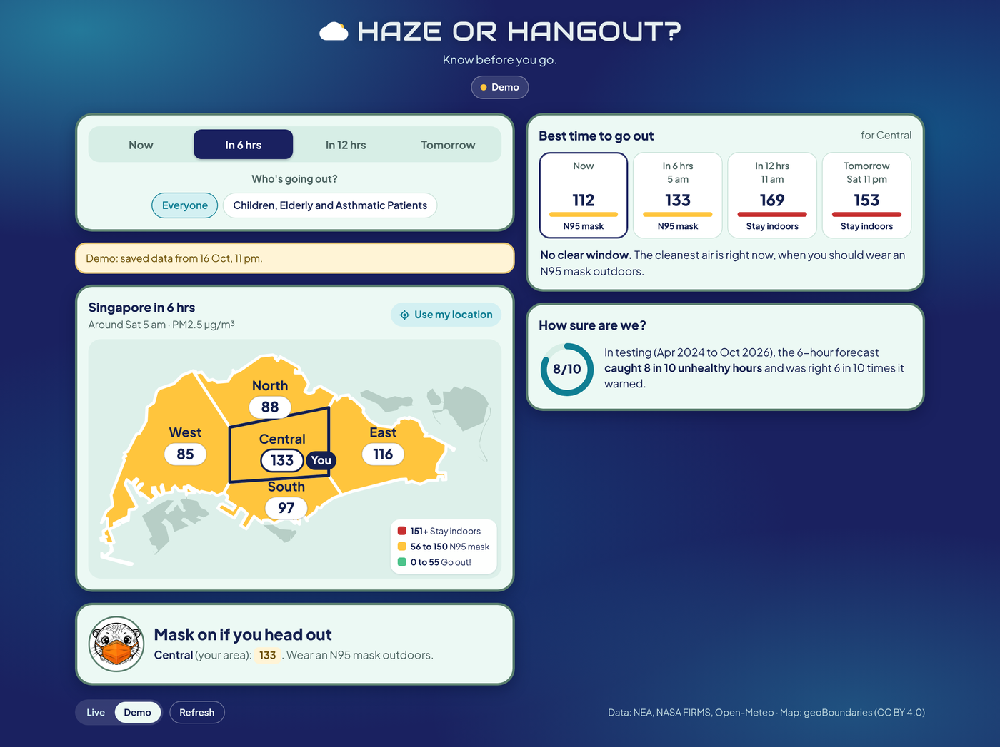

# HazeCast SG User Guide

This guide explains how to use the **Haze or Hangout?** web app: every part of the screen, every status message, and what to do if something does not work as expected. No background in data science is required.

<p align="center">
  
</p>

---

## Contents

1. [Quick start](#1-quick-start)
2. [What PM2.5 means](#2-what-pm25-means)
3. [Opening the app](#3-opening-the-app)
4. [A tour of the screen](#4-a-tour-of-the-screen)
5. [Colours and advice](#5-colours-and-advice)
6. [Each feature, step by step](#6-each-feature-step-by-step)
7. [Messages you might see](#7-messages-you-might-see)
8. [Frequently asked questions](#8-frequently-asked-questions)
9. [Troubleshooting](#9-troubleshooting)
10. [For developers](#10-for-developers)

---

## 1. Quick start

**Five steps to a decision:**

1. **Open the app** (see [Opening the app](#3-opening-the-app)).
2. **Choose a time:** tap **Now**, **In 6 hrs**, **In 12 hrs** or **Tomorrow**.
3. **Choose who's going out:** **Everyone**, or **Children, Elderly and Asthmatic Patients**.
4. **Choose your region:** tap **Use my location**, or tap your part of the map.
5. **Read the advice** in the card under the map, and check **Best time to go out**.

---

## 2. What PM2.5 means

**PM2.5** is the amount of very fine dust and smoke in the air. The particles are smaller than 2.5 micrometres, about **thirty times thinner than a human hair**, so they get deep into the lungs.

- It is measured in **micrograms per cubic metre** of air, written **µg/m³**.
- **Lower is better.** On a normal day in Singapore it sits around 10 to 30.
- During **bad haze** it can go above 200.

---

## 3. Opening the app

| Where you are | How to open it | What you see |
|---|---|---|
| **Team computer running Docker** | Go to <http://localhost:8000> | **Live** forecasts, updated every hour |
| **GitHub Pages** (if switched on for the repo) | Open the Pages link | The **Demo** snapshot |
| **Any computer, no server** | Open `docs/index.html` in a browser | The **Demo** snapshot |

> [!TIP]
> On a laptop, press **Ctrl + Shift + M** in Chrome's developer tools (open them with **F12**) to see the phone layout.

---

## 4. A tour of the screen

From top to bottom:

| # | Part of the screen | What it does |
|---|---|---|
| **1** | **Title and Live/Demo label** | The label under the title says **Live** (green dot) for real-time data, or **Demo** (yellow dot) for the saved snapshot |
| **2** | **Time tabs** | **Now** shows measured readings. **In 6 hrs**, **In 12 hrs** and **Tomorrow** show forecasts |
| **3** | **Who's going out?** | **Everyone** uses NEA's bands. **Children, Elderly and Asthmatic Patients** gives stricter advice |
| **4** | **Notice bar** (yellow) | Only appears when something needs your attention, such as demo data or late data |
| **5** | **Map** | Each region is coloured by what to do, with its PM2.5 value (µg/m³) in a white badge. The line under the map title shows the time. Your region has a **dark outline** and a **You** tag |
| **6** | **Summary card** | A one-line headline for the whole island, plus the advice and PM2.5 value for your region |
| **7** | **Best time to go out** | Your region at four times, with the best one outlined |
| **8** | **How sure are we?** | How accurate this forecast has been, and the model's health check |
| **9** | **Live / Demo / Refresh** (bottom) | Switch data source by hand, or fetch the latest numbers |

On a laptop, parts 7 and 8 sit in a second column on the right.

---

## 5. Colours and advice

The map colours are **advice**, so they change when you change **Who's going out?**

**For everyone** (NEA's one-hour PM2.5 bands):

| Colour | PM2.5 (µg/m³) | Advice |
|---|---|---|
| **Green** | 0 to 55 | **Go out!** |
| **Yellow** | 56 to 150 | **Wear an N95 mask** outdoors |
| **Red** | 151 and above | **Stay indoors** |

**For children, the elderly and asthmatic patients** (one step stricter):

| Colour | PM2.5 (µg/m³) | Advice |
|---|---|---|
| **Green** | 0 to 35 | **Go out!** |
| **Yellow** | 36 to 55 | **Short trips only**, with a mask |
| **Red** | 56 and above | **Stay indoors** if you can |

> [!NOTE]
> The stricter rule is **our own cautious choice**, not an official NEA one. For official advice, check [haze.gov.sg](https://www.haze.gov.sg).

**Summary headlines.** The headline in the summary card reflects all five regions:

| Headline | What it means |
|---|---|
| **Outdoors! Enjoy the sun** | Every region is green |
| **Outdoors, with a mask in places** | Some regions are yellow, none are red |
| **Mask on if you head out** | Every region is yellow |
| **Depends where you are** | At least one region is red |
| **Stay indoors** | Every region is red |
| **Waiting for a new forecast** | The forecast's target time has passed and a new one hasn't arrived yet |

---

## 6. Each feature, step by step

### Use my location

1. Tap **Use my location** above the map. On smaller phones it says **My location**.
2. When your browser asks to share your location, tap **Allow**.
3. The app picks the **nearest of the five regions** and marks it with the **You** tag.

**Privacy and behaviour:**
- **Your location never leaves your device.** The app only uses it to pick the nearest region. Nothing is sent to our server or saved.
- The app remembers your **region name** (for example "Central") in your browser, so it opens on the same region next time.
- Location only works on a secure web address (https) or on localhost. If you would rather not share it, just **tap your region on the map**.

### Who's going out?

1. Tap **Everyone** or **Children, Elderly and Asthmatic Patients**.
2. The map colours, the legend and the advice all update straight away.
3. The app remembers your choice next time.

### Best time to go out

This card compares **your region** at four times: **Now**, **In 6 hrs**, **In 12 hrs** and **Tomorrow**.

- The slot with the **dark border** is the best one: the **first slot that is green**, or if none are green, the one with the **lowest number**.
- Below the slots, one line tells you what to do, for example *"Best window: around 11 am"* or *"No clear window. The cleanest air is right now..."*.
- Times are **approximate**: "around 11 am" means the forecast for that hour, not a guaranteed window.

### How sure are we?

This card reports how reliable the selected forecast has been, so users can judge how much weight to give it.

- **On a forecast tab**, the ring shows how many **truly unhealthy hours** that forecast warned about when we tested it on April 2024 to October 2026. For example, **8/10** for the 6-hour forecast.
- **"Right N in 10 times it warned"** tells you how often a warning turned out to be a real unhealthy hour.
- **On the Now tab**, the ring says **Real**, because those are measured readings, not a forecast.
- The forecast **leans to the safe side** on purpose: the number shown is a cautious estimate, so the real level is usually **at or below** it.

**The model check** at the bottom of the card shows the result of the nightly health check. It appears in **Live** mode only:

| Indicator | Message | Meaning |
|---|---|---|
| Green | **Model check: all good** | Data and accuracy look normal |
| Yellow | **Model check: under review** | Something looks off and a person should take a look |
| Orange | **Model check: retraining** | Retraining has been triggered |
| Red | **Model check: data issue** | A data source needs fixing |
| Grey | **Model check: not run yet** | No check has run on this machine yet |

---

## 7. Messages you might see

| Message | What it means | What to do |
|---|---|---|
| *"Demo: saved data from 16 Oct, 11 pm."* | The app is showing the saved demo, either because you chose **Demo** or because the server could not be reached | Tap **Live** at the bottom. If it stays on Demo, start the server (see the [README](../README.md#getting-started)) |
| *"These forecasts were made from data N hours old. No new forecast until fresh data arrives (waiting for ...)"* | A data source is late. The app names which one | Wait for the next hourly run. The app keeps checking every minute |
| *"N of 3 target times have passed and are greyed out."* | Some forecast times are already in the past | Greyed slots and crossed-out numbers are **no longer forecasts**. Use the ones still ahead |
| *"Satellite fire data is N hours late, so this forecast uses the last fire counts received."* | NASA's fire data hasn't arrived yet | Nothing. The forecast still works, using the last fire counts |
| *"Latest readings aren't available right now. Try a forecast tab."* | The Now tab has no readings to show | Use **In 6 hrs** or later |
| *"Your browser can't share location..."* or *"We couldn't get your location..."* | Location is blocked or unavailable | **Tap your region** on the map instead |
| *"You seem to be outside Singapore..."* | You are more than about 30 km from Singapore | **Tap the region** you are heading to |

---

## 8. Frequently asked questions

**Is this a mobile app?**
It is a **web app**: a website designed phone-first. It runs in any browser on a phone, tablet or laptop, with nothing to install.

**Why can Now and the forecasts disagree a lot?**
Haze can change quickly when the wind shifts. The forecast also leans high **on purpose**, as explained in [How sure are we?](#how-sure-are-we).

**Why is my region yellow when it looks clear outside?**
PM2.5 particles are too small to see at lower levels. Haze usually only becomes visible well into the yellow range.

**How often does it update?**
A new forecast is made at **10 minutes past every hour**. The open page checks for new numbers **every minute**.

**Where do the numbers come from?**
PM2.5 from **NEA** via data.gov.sg, wind and rain from **Open-Meteo**, and fire hotspots from **NASA FIRMS**.

**Is this official advice?**
**No.** It is a student project. For official advice, check [haze.gov.sg](https://www.haze.gov.sg).

---

## 9. Troubleshooting

| Problem | Likely cause | Fix |
|---|---|---|
| The label says **Demo** when you expected **Live** | The server isn't running, or has no forecast yet | Run `docker compose up -d`, then in Airflow check that `hazecast_hourly` has run |
| A yellow note says the data is **many hours old** | The hourly job is skipping because data is late, or Docker was off | Check `hazecast_hourly` in Airflow at <http://localhost:8080>. It skips on purpose rather than show an old forecast as current |
| **Use my location** does nothing | The page was opened as a file, or location is blocked | Open it via <http://localhost:8000>, or allow location in your browser settings |
| The page looks unstyled or broken | An old copy is cached | Refresh with **Ctrl + F5** |

---

## 10. For developers

**Where the app lives.** The whole page is one file: **`serving/static/index.html`**. An identical copy, **`docs/index.html`**, serves GitHub Pages. **After editing the page, copy it over `docs/index.html`**, because a test checks the two match.

**The API endpoints it uses:**

| Endpoint | What it gives the app |
|---|---|
| `/forecast/hourly` | The 6, 12 and 24 hour forecasts for each region and Singapore as a whole |
| `/context` | The latest measured readings, test accuracy per horizon and the model health check |
| `/health/sources` | How fresh each data source is, so the app can name a late one |
| `/config` | The NEA threshold the model was tested against |
| `/health` | Whether the API itself is running |

**How it behaves when something is missing:**
- If **`/forecast/hourly`** fails, the app switches to the **demo** snapshot built into the page.
- If **`/context`** fails, forecasts still show. Only the Now tab and accuracy details are affected.
- **Greying out** passed target times only happens in **Live** mode, never on the demo.

**Testing.** Run the full suite from the repo root:

```bash
export PYTHONPATH=src:.
pytest -q
```

`tests/test_api.py` checks that the page only calls endpoints that exist, rounds its numbers, flags stale data, greys out passed times, and matches `docs/index.html`.

**Built-in assets.** The fonts (Audiowide and Plus Jakarta Sans, SIL Open Font License), the otter mascots and the demo data are embedded in the page, so it works fully offline.
